<h1 align="center">Hi, I'm Tiago</h1>

<strong>Full Stack Developer</strong>

  

I build full stack web applications with responsive, accessible interfaces, back-end logic, API integrations and databases.

## Tech stack

- **Front end** — React, TypeScript, JavaScript, HTML5, CSS3, Tailwind CSS
- **Back end and database** — PHP, MySQL
- **Version control** — Git

## Find me online

[LinkedIn](https://www.linkedin.com/in/tiago-portella-53aa76264/) · [GitHub repositories](https://github.com/tiago220403?tab=repositories)
